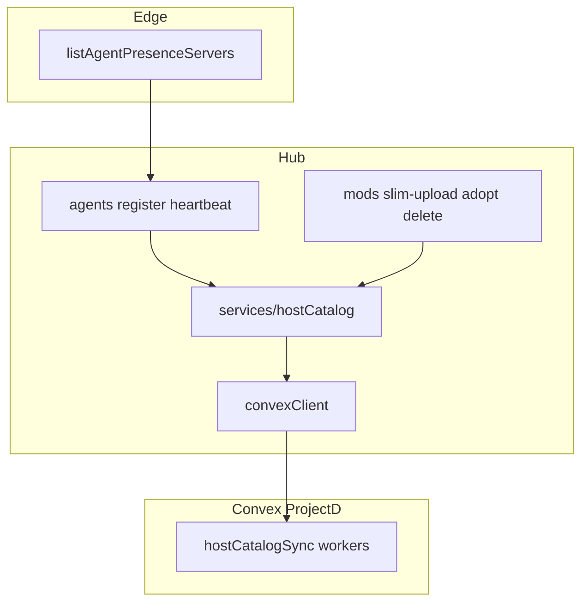

# Host catalog sync (hub → Convex)

**Source of truth** for how the hub pushes cars, tracks, and server folders into ProjectD Convex.  
Handoffs should link here instead of duplicating mutation / env detail.

MVP product flow: [examples/PROJECTD_WEB_CONVEX_HUB_HANDOFF.md](./examples/PROJECTD_WEB_CONVEX_HUB_HANDOFF.md).  
Platform overview: [SERVER_PLATFORM.md](./SERVER_PLATFORM.md).

---

## What this is

Hub module [`packages/ac-data-backend/src/services/hostCatalog/`](../packages/ac-data-backend/src/services/hostCatalog/) calls ProjectD **worker mutations** (same secret style as lap ingest) so Convex tables stay in sync with:

- Mod packages finalized / force-deleted on the hub
- Edge agent presence `servers[]` (VPS folders)

Failures are logged; they do **not** fail upload, delete, or presence.

---

## Flow

### Cars / tracks

| Hub event | Sync |
|-----------|------|
| Edge slim-upload/commit or adopt → hub `register-local` (`edge_folder`) | `syncHostCatalogUpsert` → upsert car/track |
| Force delete (`orchestrator`) | `syncHostCatalogDelete` → delete car/track |

Slug = package `acContentSlug`. Skins / layouts come from slim tree / manifest entry paths when available.

### Servers

| Hub event | Sync |
|-----------|------|
| Agent register / heartbeat with `servers[]` | `syncHostCatalogServersFromPresence` |

Edge sole source of `servers[]`: `listAgentPresenceServers` in `controlApiAgentPresence.ts` (folder names on the VPS).  
Hub only upserts/deletes Convex `servers` when the **set of folder names** changes (not every heartbeat).

---

## Env (hub)

| Variable | Default / meaning |
|----------|-------------------|
| `CONVEX_HOST_CATALOG_SYNC` | On when unset; set `false` to disable |
| `CONVEX_URL` / Convex client | Required (`isConvexConfigured`) |
| `CONVEX_WORKER_SECRET` | Required; passed as `workerSecret` on mutations |
| `CONVEX_HOST_CATALOG_UPSERT_CAR` | Override path (default below) |
| `CONVEX_HOST_CATALOG_DELETE_CAR` | … |
| `CONVEX_HOST_CATALOG_UPSERT_TRACK` | … |
| `CONVEX_HOST_CATALOG_DELETE_TRACK` | … |
| `CONVEX_HOST_CATALOG_UPSERT_SERVER` | … |
| `CONVEX_HOST_CATALOG_DELETE_SERVER` | … |
| `HOST_CATALOG_DEFAULT_REGION` | Fallback region for server upsert (`EU` if unset). Must be `EU` / `NA` / `SA` / `APAC` |

Defined in `services/hostCatalog/env.ts`.

Hub client uses `CONVEX_DEPLOYMENT_URL` + `CONVEX_PRODUCT_KEY` (see `isConvexConfigured`), not a bare `CONVEX_URL`.

Server upsert also reads `FLEET_EDGE_REGISTRY` (by `instanceId`) for `region` / `vpsLabel` / `linkServers` when present.

### Diagnose: upload OK but Convex empty

After a slim-upload / adopt, watch the **hub** process logs:

| Log | Meaning |
|-----|---------|
| `[host-catalog] upsert car\|track …` | Sync succeeded |
| `[host-catalog] upsert failed …` or `[edge-register] host catalog sync skipped` | Mutation/secret/path error (upload still `ok`) |
| `[host-catalog] sync disabled …` | Flag off, Convex not configured, or missing `CONVEX_WORKER_SECRET` |
| No host-catalog line at all | Old hub build, or register-local never reached |

Admin / register-local JSON also includes `hostCatalogSynced` + optional `hostCatalogSyncError`.

---

## ProjectD worker contract

Implement in ProjectD: `convex/worker/hostCatalogSync.ts` (not in this repo).  
Payloads are **metadata only** (no ZIPs / binaries). Every mutation includes `workerSecret`.

Default mutation paths:

| Op | Path |
|----|------|
| Upsert car | `worker/hostCatalogSync:workerUpsertBattleCar` |
| Delete car | `worker/hostCatalogSync:workerDeleteBattleCar` |
| Upsert track | `worker/hostCatalogSync:workerUpsertBattleTrack` |
| Delete track | `worker/hostCatalogSync:workerDeleteBattleTrack` |
| Upsert server | `worker/hostCatalogSync:workerUpsertServer` |
| Delete server | `worker/hostCatalogSync:workerDeleteServer` |

`workerUpsertServer` resolves `vps_hosts` by `instanceId` (= edge `AC_INSTANCE_ID`).

### Car — `workerUpsertBattleCar`

| Field | Notes |
|-------|--------|
| `workerSecret` | required |
| `carModel` | required — AC slug / key |
| `name` | required |
| `skins` | optional `string[]` |
| `coverImageId` | optional — hub does not send |
| `isEventOnly` | optional — worker default `true`; hub does not send |

Delete: `{ workerSecret, carModel }`

### Track — `workerUpsertBattleTrack`

| Field | Notes |
|-------|--------|
| `workerSecret` | required |
| `track` | required — slug / key |
| `name` | required |
| `configTrack` | **required** `string[]` — hub sends `["default"]` when no layouts detected |
| `coverImageId` | optional — hub does not send (no `mapImageId`) |
| `isEventOnly` | optional — worker default `true`; hub does not send |

Delete: `{ workerSecret, track }`

### Server — `workerUpsertServer`

| Field | Notes |
|-------|--------|
| `workerSecret` | required |
| `instanceId` | required — e.g. `vps-eu-2` |
| `name` | required — AC folder, e.g. `server-1` |
| `region` | conditional — `EU` / `NA` / `SA` / `APAC`; needed when VPS row is new. Hub always sends (presence / fleet / `HOST_CATALOG_DEFAULT_REGION` / `EU`) |
| `linkServers` | optional — join URL (from fleet `joinIp` when available) |
| `vpsLabel` | optional — from fleet registry `label` |
| `isActive` / `publicAccess` | optional — **create** ignores and forces `isActive: false`, `publicAccess: true`. Hub **does not** send `isActive` on folder discovery (presence ≠ start). Send `isActive` only from start/stop lifecycle |

Delete: `{ workerSecret, instanceId, name }`

---

## What this is **not**

- **Not** allocate / `server_slots` / Host start (phase 2 / Redis desired-config) — see [SERVER_PLATFORM.md](./SERVER_PLATFORM.md)
- **Not** treating hub `GET /v1/mods` as the Host product catalog (that is Convex `battle_*` / `servers`)
- **Not** live player presence into Convex (`LIVE_INGEST_CONVEX=false`)

Mod ensure and distribute remain ops APIs; they do not replace this catalog sync.
