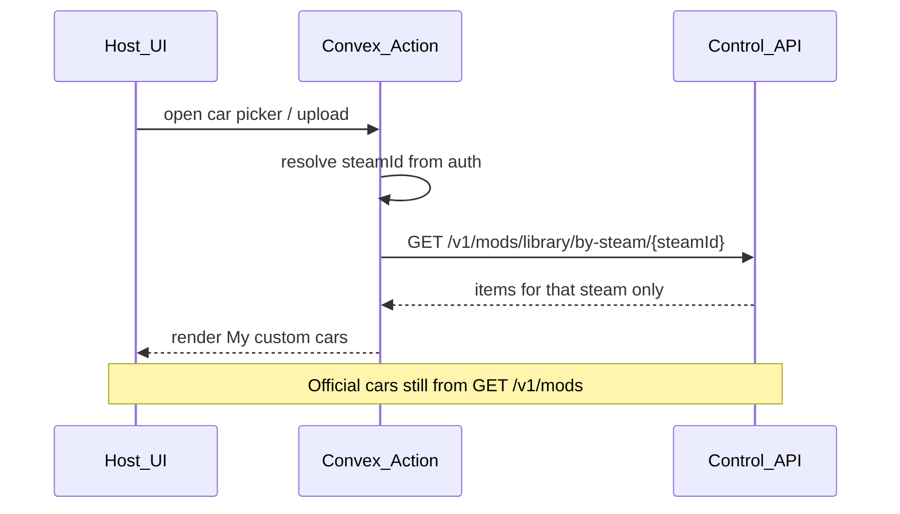

# ProjectD Host — Custom cars del usuario (brief de integración)

Documento para el equipo **ProjectD** (Host / Convex). El hub (`assetto-infra` Control API) ya expone la API. Host solo consume.

Relacionado: [CONTROL_API_V1.md](./CONTROL_API_V1.md) (sección *User library*), OpenAPI [openapi/control-api-v1.yaml](./openapi/control-api-v1.yaml).

---

## Principio

| Dónde | Qué guarda / hace |
|-------|-------------------|
| **Hub** | Blob S3 + `mod_packages` + `mod_steam_links (steamId ↔ packageId)` |
| **Convex / Host** | Auth → `steamId`. **No** tabla `customCar` con metadata del mod |
| **UI Host** | En el picker del server: “My custom cars” = solo lo que el hub linkó a ese `steamId` |

Catálogo oficial (battle cars / ops library) sigue siendo `GET /v1/mods`. Custom cars son **otro listado**, filtrado por usuario.



---

## Auth

- Browser **nunca** ve `CONVEX_WORKER_SECRET`.
- Convex Action (o Next BFF) llama al hub con header `X-Worker-Secret`.
- Base URL: `CONTROL_API_URL` / `AC_DATA_BASE_URL` (igual que el resto de Control API).
- El hub **confía** en el `steamId` que manda Convex (Convex ya autenticó al user). Formato Steam64: `7656119` + 10 dígitos.

---

## Endpoints a usar

### 1. Listar (picker Host)

`GET /v1/mods/library/by-steam/:steamId`

Respuesta (resumen):

```json
{
  "ok": true,
  "steamId": "76561199…",
  "items": [
    {
      "packageId": "uuid",
      "slug": "…",
      "displayName": "…",
      "kind": "car",
      "acContentSlug": "…",
      "category": null,
      "previewImageFilename": null,
      "linkedAt": "…",
      "artifactId": "uuid",
      "contentHash": "…",
      "sizeBytes": 123
    }
  ]
}
```

**UI:** en el flujo de configurar/crear server, sección “Custom cars” = este array filtrado `kind === "car"` (tracks igual si se habilitan). No mezclar con el catálogo público sin etiquetar.

### 2. Subir — ZIP (recomendado para Host)

**ProjectD no filtra slim ni calcula hashes.** El usuario elige un ZIP del coche → BFF manda el ZIP al hub → el hub hace slim + contentHash + S3 + link `steamId`.

UI sugerida: botón **Custom car** (junto a Reset) → file picker `.zip` → Action → refresh My custom cars.

```http
POST /v1/mods/library/zip-upload
Header: X-Worker-Secret: <secret>
Content-Type: multipart/form-data
```

Campos:

| Campo | Obligatorio | Descripción |
|-------|-------------|-------------|
| `file` | sí | ZIP del coche/track |
| `steamId` | sí | Steam64 del usuario |
| `kind` | sí | `car` o `track` |
| `slug` | no | override; si no, se infiere de la carpeta del ZIP |
| `displayName` | no | nombre para UI |

Ejemplo (BFF):

```bash
curl -X POST "$CONTROL_API_URL/v1/mods/library/zip-upload" \
  -H "X-Worker-Secret: $CONVEX_WORKER_SECRET" \
  -F "file=@/path/to/my_car.zip" \
  -F "steamId=76561199000000001" \
  -F "kind=car" \
  -F "displayName=My Custom Civic"
```

**Respuesta** (nuevo o ya existía el mismo contenido):

```json
{
  "ok": true,
  "status": "uploaded",
  "packageId": "…",
  "artifactId": "…",
  "contentHash": "…",
  "kind": "car",
  "acContentSlug": "my_car",
  "displayName": "My Custom Civic",
  "linked": true,
  "steamId": "76561199000000001"
}
```

Si el mismo árbol slim ya está en S3: `status: "already_present"` — solo se añade el link (no re-sube blob). Luego: `GET …/by-steam/{steamId}`.

Estructura ZIP aceptada (cualquiera):

- `my_car/data.acd` + slim files
- `cars/my_car/...`
- `content/cars/my_car/...`

El hub rechaza path traversal (`../`) en entradas del ZIP (`400`).

Límites: ~500MB / 5000 slim files. Sin host-catalog público.

**No hace falta** copiar `isServerSlimRelativePath` / `contentHashFromFileEntries` en ProjectD.

#### Avanzado: slim-upload plan/put/commit

Solo si un cliente quiere subir archivo a archivo (ops). Host **no** debe implementarlo. Ver OpenAPI `/v1/mods/library/slim-upload/*`.

### 3. Instalar en el VPS al usar el server

Cuando el user elige un custom car en el preset/config del server:

- Incluir `acContentSlug` / `artifactId` en desired-config como cualquier otro coche.
- Antes de start: `POST /v1/instances/:instanceId/mods/ensure` con ese `artifactId` (o `cars: [{ modId }]`).
- Availability: `GET /v1/mods/availability?instanceId=` igual que mods oficiales.

### 4. Borrar de “mis custom cars”

`DELETE /v1/mods/library/:packageId` con `steamId` (body o query).

- Otros users con el mismo mod → solo se quita el link; el blob sigue.
- Último user → hub borra S3 + VPS caches.
- `409 mod_in_use` → el mod está en un server config; Host debe pedir quitarlo del server primero.

---

## Qué NO hacer en ProjectD

- No crear tabla Convex `customCars` / `customCar` con slug, nombre, hash, s3Key como catálogo.
- No listar custom cars desde `GET /v1/mods` (eso es library central/ops, no “míos”).
- No llamar al hub desde el browser con el worker secret.
- No asumir que custom car está en disco del VPS hasta que `ensure` diga LOCAL/READY.

---

## Entregables Host (checklist)

1. Action `listMyCustomMods(steamId)` → proxy GET by-steam; cache corta opcional en Action, no DB Convex.
2. UI server host: picker muestra **oficiales** + **My custom cars** (solo respuesta by-steam).
3. Al seleccionar custom car → persistir `acContentSlug` / `artifactId` en preset Convex (eso sí es config del server, no catálogo del mod).
4. Pipeline start: ensure artifact en el `instanceId` del server.
5. UI upload: ZIP → `POST /v1/mods/library/zip-upload` + delete con ToS (“contenido responsabilidad del usuario”).
6. Manejo errores: `401` secret, `400` steamId/unsafe zip, `409` mod_in_use, `already_present` / `uploaded` en zip-upload.

---

## Fuera de alcance de este brief

- Moderación / DMCA en hub.
- Compartir custom car con otro steam sin re-subir (mismo hash → plan `already_present`, o futuro `POST …/link`).
- Cambios en `assetto-infra` (API ya en el hub).
