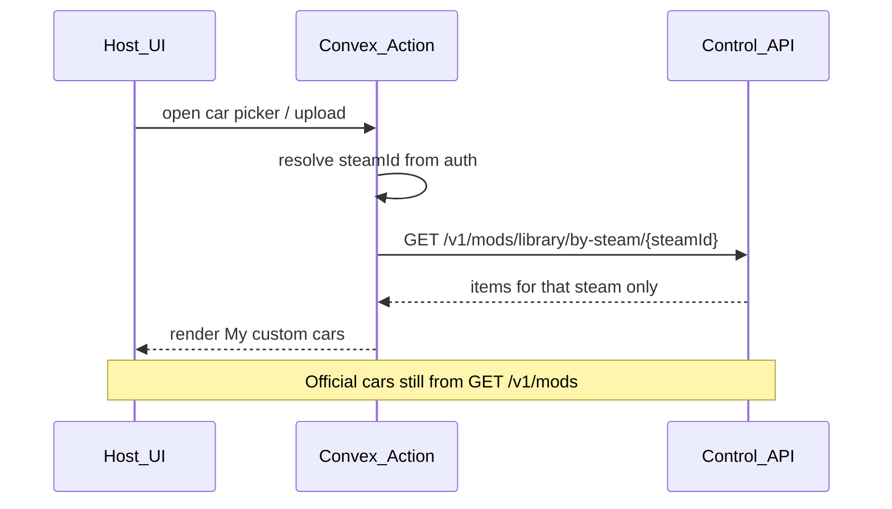
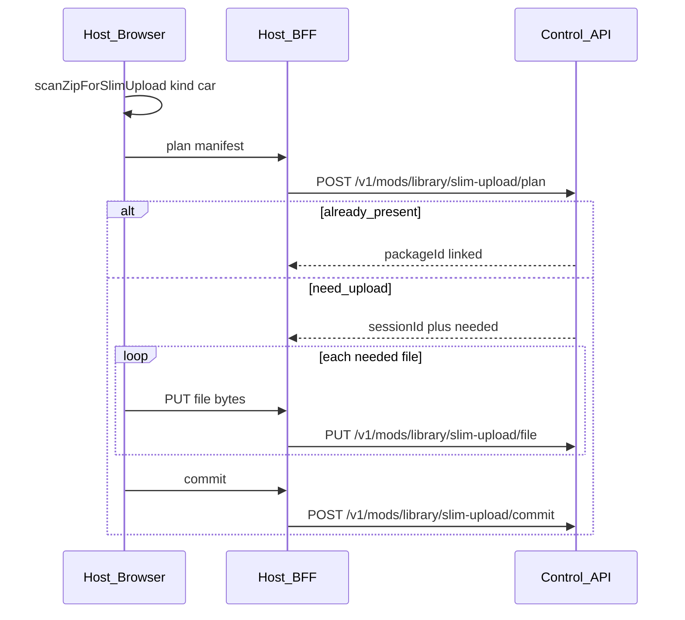

# ProjectD Host — Custom cars del usuario (brief de integración)

Documento para el equipo **ProjectD** (Host / Convex). El hub (`assetto-infra` Control API) ya expone la API. Host solo consume.

Relacionado: [CONTROL_API_V1.md](./CONTROL_API_V1.md) (sección *User library*), OpenAPI [openapi/control-api-v1.yaml](./openapi/control-api-v1.yaml). Custom tracks (mismo library, `kind=track`): [PROJECTD_CUSTOM_TRACKS_HOST.md](./PROJECTD_CUSTOM_TRACKS_HOST.md).

---

## Principio

| Dónde | Qué guarda / hace |
|-------|-------------------|
| **Hub** | Blob S3 + `mod_packages` + `mod_steam_links (steamId ↔ packageId)` |
| **Convex / Host** | Auth → `steamId`. **No** tabla `customCar` con metadata del mod |
| **UI Host** | En el picker del server: “My custom cars” = solo lo que el hub linkó a ese `steamId` |

Catálogo oficial (battle cars / ops library) sigue siendo `GET /v1/mods`. Custom cars son **otro listado**, filtrado por usuario.



---

## Auth

- Browser **nunca** ve `CONVEX_WORKER_SECRET`.
- Convex Action (o Next BFF) llama al hub con header `X-Worker-Secret`.
- Base URL: `CONTROL_API_URL` / `AC_DATA_BASE_URL` (igual que el resto de Control API).
- El hub **confía** en el `steamId` que manda Convex (Convex ya autenticó al user). Formato Steam64: `7656119` + 10 dígitos.

---

## Endpoints a usar

### 1. Listar (picker Host)

`GET /v1/mods/library/by-steam/:steamId`

Respuesta (resumen):

```json
{
  "ok": true,
  "steamId": "76561199…",
  "items": [
    {
      "packageId": "uuid",
      "slug": "…",
      "displayName": "…",
      "kind": "car",
      "acContentSlug": "…",
      "category": null,
      "previewImageFilename": null,
      "linkedAt": "…",
      "artifactId": "uuid",
      "contentHash": "…",
      "sizeBytes": 123,
      "skins": ["00_black", "05_white"]
    }
  ]
}
```

**UI:** en el flujo de configurar/crear server, sección “Custom cars” = este array filtrado `kind === "car"`. Usar `items[].skins` como lista de skin ids (nombres de carpeta) para el picker / `entry_list` — **no** un fallback de “slots”. Misma idea que coches oficiales. Para tracks (`skins: []`, layouts, ensure): [PROJECTD_CUSTOM_TRACKS_HOST.md](./PROJECTD_CUSTOM_TRACKS_HOST.md).

### 2. Subir — slim en el navegador (recomendado)

**Preferido:** el browser hace unzip + filtro server-slim + hashes (CPU/RAM del usuario) y solo sube los bytes slim. El BFF de Host (con `X-Worker-Secret`) llama al Control API. Misma lógica que el panel admin, pero sin exponer el secret al cliente.

Scan en Host: paquete `@projectd/ac-mod-slim-client` (vive en el monorepo **ProjectD Host**, no en assetto-infra). Allowlist slim alineada con hub [`serverSlimPaths`](../packages/ac-data-shared/src/mods/serverSlimPaths.ts).



UI custom cars: forzar **`kind=car`**. File picker `.zip` → progreso de scan → progreso de PUT → refresh `by-steam`.

#### 2a. Scan en el browser

```ts
import {
  scanZipForSlimUpload,
  slimScanToPlanFiles,
  SLIM_SCAN_WARN_RAW_BYTES,
  formatBytes,
} from '@projectd/ac-mod-slim-client';

const scan = await scanZipForSlimUpload(file, 'car');
// scan.slug, scan.expectedContentHash, scan.files[].bytes
if (scan.rawBytes > SLIM_SCAN_WARN_RAW_BYTES) {
  // avisar o usar fallback zip-upload (§2c)
}
```

El scan carga el ZIP en memoria del usuario. Umbral sugerido: ~250 MB raw → ofrecer fallback ZIP.

#### 2b. Contrato BFF → Control API (headers/body exactos)

Auth en todas las llamadas hub: `X-Worker-Secret: <secret>`.

**1) Plan** — `POST /v1/mods/library/slim-upload/plan`  
`Content-Type: application/json`

```json
{
  "steamId": "76561199000000001",
  "kind": "car",
  "slug": "civic",
  "displayName": "My Custom Civic",
  "expectedContentHash": "<64 hex>",
  "files": [
    { "rel": "data.acd", "size": 123, "sha256": "<64 hex>" }
  ]
}
```

Respuestas 200:

| `status` | Qué hacer |
|----------|-----------|
| `already_present` | Ya hay blob; hub ya linkó `steamId`. Refresh by-steam. Campos: `packageId`, `artifactId`, `contentHash`, `slug` / `acContentSlug`, `requestedSlug`, `slugAllocated: false`. `needed: []`. |
| `need_upload` | Seguir con PUT. Campos: `sessionId`, `needed[]`, `skip[]`, `neededBytes`, `skipBytes`, **`slug`** (final), **`requestedSlug`**, **`slugAllocated`**, `displayName`. Si `slugAllocated`, el hub guardará como `{requested}-cN` (variante distinta al slug de carpeta). |

**2) File** — `PUT /v1/mods/library/slim-upload/file`  
Body: **raw bytes** (`application/octet-stream` o `*/*`). Headers (nombres exactos, case-insensitive en Express):

| Header | Valor |
|--------|--------|
| `X-Slim-Session-Id` | `sessionId` del plan |
| `X-Slim-Rel` | path relativo slim (ej. `data.acd`, `skins/00_black/ui_skin.json`) |
| `X-Slim-Sha256` | sha256 hex lowercase del body |

Solo subir archivos listados en `needed`. Respuesta 200: `{ ok, rel, sha256, size }`.

**3) Commit** — `POST /v1/mods/library/slim-upload/commit`  
`Content-Type: application/json`

```json
{
  "sessionId": "<from plan>",
  "steamId": "76561199000000001"
}
```

Respuesta 200 típica: `{ ok, status: "uploaded", packageId, artifactId, contentHash, kind, slug, requestedSlug, slugAllocated, acContentSlug, displayName, linked, steamId, skins: [...] }`.

Si `slugAllocated: true`, mostrar toast “Guardado como `{slug}`” (p. ej. `pk_gunma-c1` cuando el nombre de carpeta ya existía con otro contenido).

Errores útiles: `400` validación / missing staged file; `401` secret; `404` session expired; `409` hash/size/steamId mismatch o `slug_allocate_exhausted`; `503` S3 mode off.

Límites control: ~500 MB slim tree / 5000 files (`CONTROL_MOD_UPLOAD_MAX_*`). Sin host-catalog público.

#### 2c. Fallback — ZIP al hub

Si el scan falla o el ZIP es demasiado grande para el cliente:

```http
POST /v1/mods/library/zip-upload
Header: X-Worker-Secret: <secret>
Content-Type: multipart/form-data
```

| Campo | Obligatorio | Descripción |
|-------|-------------|-------------|
| `file` | sí | ZIP del coche |
| `steamId` | sí | Steam64 |
| `kind` | sí | `car` (custom cars) |
| `slug` | no | override |
| `displayName` | no | nombre UI |

El hub hace extract + slim + S3 + link. Más lento (ZIP completo en red + CPU hub). Misma política de slug que slim: mismo hash → `already_present`; slug ocupado + contenido distinto → `slugAllocated` / `{slug}-cN`.

Estructura ZIP aceptada: `my_car/…`, `cars/my_car/…`, `content/cars/my_car/…`. Path traversal → `400`.
### 3. Instalar en el VPS al usar el server

Cuando el user elige un custom car en el preset/config del server:

- Incluir `acContentSlug` / `artifactId` en desired-config como cualquier otro coche.
- Antes de start: `POST /v1/instances/:instanceId/mods/ensure` con ese `artifactId` (o `cars: [{ modId }]`).
- Availability: `GET /v1/mods/availability?instanceId=` igual que mods oficiales.

### 4. Borrar de “mis custom cars”

`DELETE /v1/mods/library/:packageId` con `steamId` (body o query).

- **Siempre** quita el link de ese `steamId` (sale de “My custom cars”), aunque el coche siga en un server preset.
- Otros users con el mismo mod → blob sigue (`status: unlinked`, `remainingLinks > 0`).
- Último link y **nadie** lo requiere en servers → hub purga S3 + VPS (`status: purged`).
- Último link y servers que lo listan estánagados (`idle`) o sin requirements → purge S3+VPS+hub (`status: purged`). Convex catálogo **no** se borra (slug identificador).
- Último link pero algún server que lo requiere sigue **live** (o presence desconocida) → link borrado, package/S3 **se mantienen** (`status: unlinked`, `purgeSkipped: "mod_in_use"`, `usage` = servers que bloquean). Host **no** debe bloquear el delete por preset; refrescar `by-steam` tras 200.

---

## Arranque de server — fases (no confundir con desired-config ok)

**Brief para el equipo web:** [examples/HOST_SERVER_LIFECYCLE.md](./examples/HOST_SERVER_LIFECYCLE.md) (checklist + contrato + poll).

Tras Convex `isActive` / desired-config, el hub responde `{ ok: true }` cuando el snapshot se **empuja** al edge — **no** cuando el proceso está ONLINE.

Host debe poll `GET /v1/agents/:instanceId` (BFF + worker secret), localizar el slot por lobby/`serverId`, y esperar:

1. `phase === "ONLINE"` → UI “En línea”
2. `phase === "FAILED"` → UI error + `phaseDetail` + reintentar
3. Mientras `PREPARING` | `CONFIGURING` | `STARTING` | `CHECKING` → mostrar el paso correspondiente (`status` será `starting`)

Campos: `phase`, `phaseDetail`, `phaseUpdatedAt` (ms). Si faltan (agente viejo o server idle), **no** asumir ONLINE. Detalle: [CONTROL_API_V1.md](./CONTROL_API_V1.md) § Agent presence.

## Qué NO hacer en ProjectD

- No crear tabla Convex `customCars` / `customCar` con slug, nombre, hash, s3Key como catálogo.
- No listar custom cars desde `GET /v1/mods` (eso es library central/ops, no “míos”).
- No llamar al hub desde el browser con el worker secret.
- No asumir que custom car está en disco del VPS hasta que `ensure` diga LOCAL/READY.
- No tratar `desired-config` `{ ok: true }` ni `status: starting` como “server listo”.

---

## Entregables Host (checklist)

1. Action `listMyCustomMods(steamId)` → proxy GET by-steam; cache corta opcional en Action, no DB Convex.
2. UI server host: picker muestra **oficiales** + **My custom cars** (solo respuesta by-steam).
3. Al seleccionar custom car → persistir `acContentSlug` / `artifactId` en preset Convex (eso sí es config del server, no catálogo del mod).
4. Pipeline start: ensure artifact en el `instanceId` del server.
5. UI upload (**preferido**): `@projectd/ac-mod-slim-client` `scanZipForSlimUpload(file, 'car')` → BFF proxy plan/file/commit → refresh by-steam.
6. Fallback: ZIP → `POST /v1/mods/library/zip-upload` si scan falla o ZIP > ~250 MB.
7. Delete con ToS (“contenido responsabilidad del usuario”).
8. Manejo errores: `401` secret, `400` steamId/manifest, `404` session/link, `409` hash mismatch en slim PUT; delete lista → `200` `unlinked` | `purged` (incl. `purgeSkipped`).

---

## Fuera de alcance de este brief

- Moderación / DMCA en hub.
- Compartir custom car con otro steam sin re-subir (mismo hash → plan `already_present`, o futuro `POST …/link`).
- Implementación UI Host en este monorepo (solo paquete cliente + API + docs).
