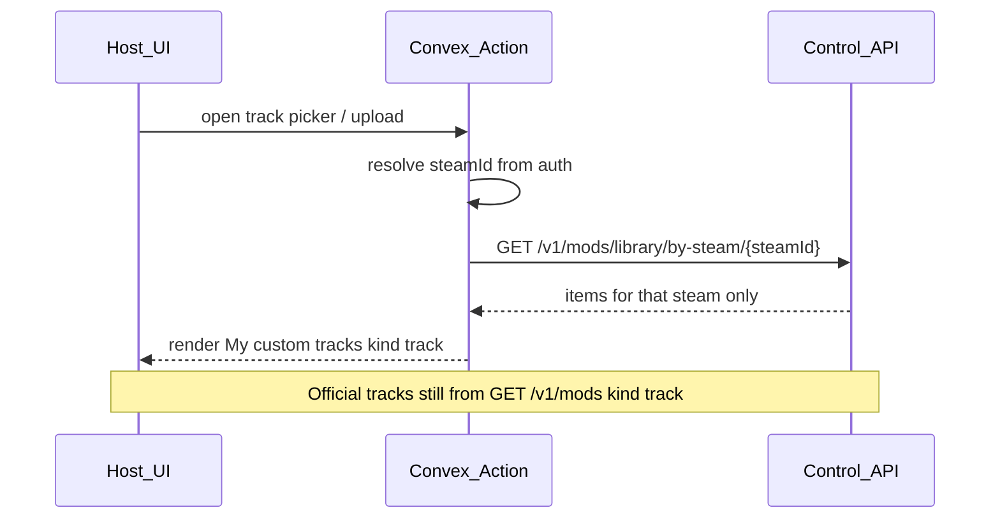
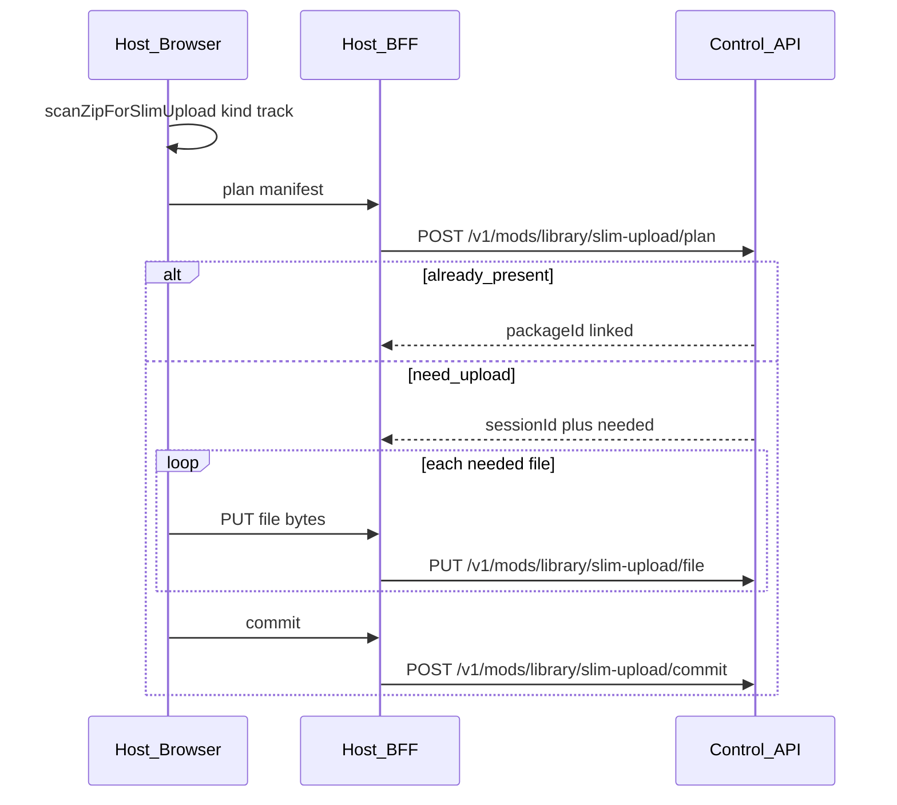

# ProjectD Host — Custom tracks del usuario (brief de integración)

Documento para el equipo **ProjectD** (Host / Convex). El hub (`assetto-infra` Control API) ya expone la API con `kind: "track"`. Host solo consume.

Relacionado:

- [PROJECTD_CUSTOM_CARS_HOST.md](./PROJECTD_CUSTOM_CARS_HOST.md) (mismo contrato library; forzar `kind=car`)
- [CONTROL_API_V1.md](./CONTROL_API_V1.md) (sección *User library*)
- OpenAPI [openapi/control-api-v1.yaml](./openapi/control-api-v1.yaml)
- Arranque: [examples/HOST_SERVER_LIFECYCLE.md](./examples/HOST_SERVER_LIFECYCLE.md)

---

## Principio

| Dónde | Qué guarda / hace |
|-------|-------------------|
| **Hub** | Blob S3 + `mod_packages` + `mod_steam_links (steamId ↔ packageId)` |
| **Convex / Host** | Auth → `steamId`. **No** tabla `customTrack` con metadata del mod |
| **UI Host** | En el picker del server: “My custom tracks” = by-steam filtrado `kind === "track"` |

Catálogo oficial (ops / battle tracks) sigue siendo `GET /v1/mods?kind=track`. Custom tracks son **otro listado**, filtrado por usuario. Misma library que custom cars; solo cambia el filtro y el `kind` en upload.



---

## Auth

Igual que custom cars:

- Browser **nunca** ve `CONVEX_WORKER_SECRET`.
- Convex Action (o Next BFF) llama al hub con header `X-Worker-Secret`.
- Base URL: `CONTROL_API_URL` / `AC_DATA_BASE_URL`.
- El hub **confía** en el `steamId` que manda Convex. Formato Steam64: `7656119` + 10 dígitos.

---

## Endpoints a usar

### 1. Listar (picker Host)

`GET /v1/mods/library/by-steam/:steamId`

Respuesta (resumen — item track):

```json
{
  "ok": true,
  "steamId": "76561199…",
  "items": [
    {
      "packageId": "uuid",
      "slug": "pk_akina",
      "displayName": "Akina downhill",
      "kind": "track",
      "acContentSlug": "pk_akina",
      "category": null,
      "previewImageFilename": null,
      "linkedAt": "…",
      "artifactId": "uuid",
      "contentHash": "…",
      "sizeBytes": 123,
      "skins": []
    }
  ]
}
```

**UI:** sección “Custom tracks” = `items.filter((i) => i.kind === "track")`.

**Layouts:** `skins` en tracks viene **siempre `[]`**. **No** usar `skins` como lista de layouts. Ver § Layouts / `CONFIG_TRACK` abajo.

### 2. Subir — slim en el navegador (recomendado)

Mismo pipeline que cars; forzar **`kind=track`**.

Scan: `@projectd/ac-mod-slim-client` → `scanZipForSlimUpload(file, 'track')`. Allowlist slim: [`serverSlimPaths`](../packages/ac-data-shared/src/mods/serverSlimPaths.ts).



UI: file picker `.zip` → progreso scan → PUT → commit → refresh by-steam. Toast si `slugAllocated: true` (“Guardado como `{slug}`”, p. ej. `pk_akina-c1`).

#### 2a. Scan en el browser

```ts
import {
  scanZipForSlimUpload,
  slimScanToPlanFiles,
  SLIM_SCAN_WARN_RAW_BYTES,
  formatBytes,
} from '@projectd/ac-mod-slim-client';

const scan = await scanZipForSlimUpload(file, 'track');
// scan.slug, scan.expectedContentHash, scan.files[].bytes
if (scan.rawBytes > SLIM_SCAN_WARN_RAW_BYTES) {
  // avisar o usar fallback zip-upload (§2c)
}
```

Umbral sugerido: ~250 MB raw → ofrecer fallback ZIP (tracks suelen ser más pesados que cars).

#### 2b. Contrato BFF → Control API

Auth: `X-Worker-Secret` en todas las llamadas.

**1) Plan** — `POST /v1/mods/library/slim-upload/plan`

```json
{
  "steamId": "76561199000000001",
  "kind": "track",
  "slug": "pk_akina",
  "displayName": "Akina downhill",
  "expectedContentHash": "<64 hex>",
  "files": [
    { "rel": "data/surfaces.ini", "size": 123, "sha256": "<64 hex>" }
  ]
}
```

| `status` | Qué hacer |
|----------|-----------|
| `already_present` | Blob ya existe; hub linkó `steamId`. Refresh by-steam. |
| `need_upload` | Seguir con PUT (`sessionId`, `needed[]`, `slug` / `requestedSlug` / `slugAllocated`). |

**2) File** — `PUT /v1/mods/library/slim-upload/file`  
Headers: `X-Slim-Session-Id`, `X-Slim-Rel`, `X-Slim-Sha256`. Body = raw bytes. Solo paths en `needed`.

**3) Commit** — `POST /v1/mods/library/slim-upload/commit`  
`{ "sessionId", "steamId" }` → `{ ok, status: "uploaded", kind: "track", slug, acContentSlug, …, skins: [] }`.

Errores / límites: mismos que cars (`CONTROL_MOD_UPLOAD_MAX_*`). Sin sync a host-catalog público.

#### 2c. Fallback — ZIP al hub

```http
POST /v1/mods/library/zip-upload
Header: X-Worker-Secret: <secret>
Content-Type: multipart/form-data
```

| Campo | Obligatorio | Descripción |
|-------|-------------|-------------|
| `file` | sí | ZIP del track |
| `steamId` | sí | Steam64 |
| `kind` | sí | **`track`** |
| `slug` | no | override |
| `displayName` | no | nombre UI |

Estructura ZIP aceptada: `my_track/…`, `tracks/my_track/…`, `content/tracks/my_track/…`. Path traversal → `400`. Misma política de slug (`already_present` / `-cN`).

### 3. Instalar en el VPS al usar el server

Cuando el user elige un custom track en el preset/config:

- Persistir `acContentSlug` / `artifactId` en el preset Convex (config del server, no catálogo del mod).
- Desired-config: campo `track` = slug del contenido (misma regla CSP que tracks oficiales, p. ej. prefijo `csp/…` si aplica).
- Antes de start: `POST /v1/instances/:instanceId/mods/ensure` con ese `artifactId`, o:

```json
{
  "tracks": [{ "modId": "pk_akina" }]
}
```

- Availability: `GET /v1/mods/availability?instanceId=` igual que mods oficiales.

### 4. Layouts / `CONFIG_TRACK`

Host debe tratar layouts **igual que tracks oficiales**:

| Concepto | Qué hacer |
|----------|-----------|
| `trackConfig` / `CONFIG_TRACK` | Layout id (carpeta bajo el track) o vacío |
| `default` / vacío / whitespace | Enviar string vacío (el edge normaliza a `CONFIG_TRACK=`) |
| Layouts en by-steam | **No** vienen en `skins` (siempre `[]` para tracks) |

Si el picker necesita la lista de layouts **antes** de start:

1. Preferir el mismo criterio que oficiales (metadatos / catálogo si ya lo tenéis).
2. Tras `ensure`, inventario VPS: `GET /v1/instances/:instanceId/mods/tracks` (configs por slug) o badges de availability.
3. Si aún no hay lista: permitir layout vacío / “default” y no inventar nombres.

No hace falta un cambio de API hub para shippear custom tracks; layouts desde inventario es suficiente.

### 5. Borrar de “mis custom tracks”

`DELETE /v1/mods/library/:packageId` con `steamId` (body o query).

Mismas reglas que cars:

- Siempre quita el link de ese `steamId`.
- Otros users → blob queda (`unlinked`).
- Último link y servers idle / sin uso live → purge S3+VPS (`purged`); Convex catalog slug se **conserva**.
- Último link pero server **live** (o presence unknown) → `unlinked` + `purgeSkipped: "mod_in_use"`.
- Host **no** bloquea delete por preset; refrescar by-steam tras 200.

---

## Arranque de server — fases

Igual que cars: [examples/HOST_SERVER_LIFECYCLE.md](./examples/HOST_SERVER_LIFECYCLE.md).

`desired-config` `{ ok: true }` ≠ ONLINE. Poll `GET /v1/agents/:instanceId` → `presence.servers[].phase`. Durante download/ensure del track, Host verá a menudo `PREPARING` (`phaseDetail` tipo waiting mods / local cars).

---

## Qué NO hacer en ProjectD

- No crear tabla Convex `customTracks` / `customTrack` como catálogo de metadata.
- No listar custom tracks solo desde `GET /v1/mods` (eso es library central/ops).
- No usar `items[].skins` como layouts de track.
- No llamar al hub desde el browser con el worker secret.
- No asumir disco VPS READY hasta `ensure` / availability LOCAL.
- No tratar `desired-config` ok ni `status: starting` como “server listo”.

---

## Entregables Host (checklist)

1. Reusar Action `listMyCustomMods(steamId)` (o equivalente) → by-steam; filtrar `kind === "track"` en UI / Action.
2. UI server: picker **oficiales** (`GET /v1/mods?kind=track`) + **My custom tracks**.
3. Al seleccionar → persistir `acContentSlug` / `artifactId` + `trackConfig` en preset.
4. Pipeline start: ensure track en el `instanceId` del server.
5. Upload preferido: `scanZipForSlimUpload(file, 'track')` → BFF plan/file/commit → refresh by-steam.
6. Fallback: ZIP → `POST /v1/mods/library/zip-upload` con `kind=track`.
7. Layout picker: oficiales / inventario post-ensure; nunca desde `skins`.
8. Delete + ToS (“contenido responsabilidad del usuario”).
9. Errores: mismos códigos que cars (`401`, `400`, `404`, `409`, delete `unlinked` \| `purged`).

---

## Fuera de alcance de este brief

- Moderación / DMCA en hub.
- Exponer `layouts[]` en by-steam (opcional futuro; hoy inventario VPS basta).
- Compartir track con otro steam sin re-subir (mismo hash → `already_present`).
- Implementación UI Host en este monorepo.
