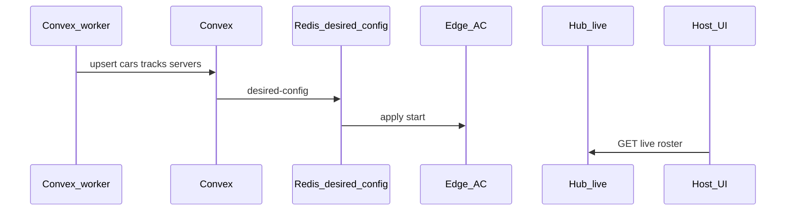

# Server platform — Host start paths

## Current Host path (only)

Catalog + start live in Convex; hub is for **live roster** (and ZIP ensure when disk is missing). Admin ops use `/admin/servers/*`.

**Host ops slots removed:** `GET/POST /v1/servers` (allocate / apply-config / start|stop by `slotId`) are **retired**. Start = Convex→Redis; live = hub. See [CONTROL_API_V1.md](./CONTROL_API_V1.md).

**Hub → Convex catalog sync** (cars/tracks on upload/delete; servers from edge presence): **[HOST_CATALOG_SYNC.md](./HOST_CATALOG_SYNC.md)**.

| Concern | Path |
|---------|------|
| Cars / tracks / servers product rows | Convex workers (`battle_cars`, `battle_tracks`, `servers`) — hub pushes via [HOST_CATALOG_SYNC.md](./HOST_CATALOG_SYNC.md) |
| Apply config / start | Convex → Redis desired-config → edge (`startHostSession` / `setPhysicalServerActive`) |
| Ops start / stop | Hub `/admin/servers/:name/start\|stop` (not `/v1/servers/:slotId/…`) |
| Connected players | Hub `GET /v1/servers/:lobby/live?instanceId=` / `GET /v1/live/summary` — **do not** flood Convex with presence |
| ZIP on VPS disk | Hub `ensure` (ops only) |

### What stays in Convex

- Presets / `battle_cars` / `battle_tracks` / `servers` product catalog.
- Auth / bookings / join links metadata.
- Lap and battle ingest; presence stay off Convex when `LIVE_INGEST_CONVEX=false`.

### What was retired (hub `/v1` slots)

- Allocate / list / apply-config / lifecycle by Postgres `server_slots` UUID.
- Table + migration `003_server_slots.sql` may remain in DB; API code no longer uses them.

## ProjectD BFF

Use Next.js `/api/control/*` (Clerk + worker secret server-side) for **live** (and ensure if needed). Handoff: [examples/PROJECTD_BFF_INSTALL.md](./examples/PROJECTD_BFF_INSTALL.md). MVP web: [examples/PROJECTD_WEB_CONVEX_HUB_HANDOFF.md](./examples/PROJECTD_WEB_CONVEX_HUB_HANDOFF.md). Live ingest: [HUD_HARDENING_CUTOVER.md](./HUD_HARDENING_CUTOVER.md).
