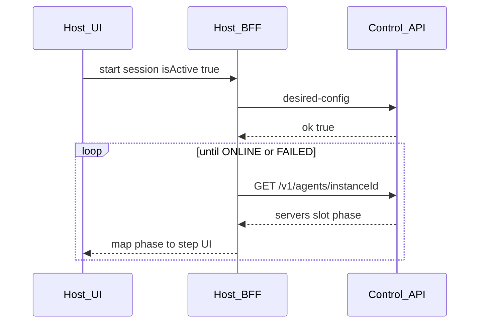

# Brief Host — estados de arranque del server (lifecycle)

Documento para el equipo **ProjectD Host / web**. Infra ya emite las fases; Host solo tiene que **leerlas y pintarlas**.

Referencias canónicas:

- [CONTROL_API_V1.md](../CONTROL_API_V1.md) § Agent presence
- [PROJECTD_CUSTOM_CARS_HOST.md](../PROJECTD_CUSTOM_CARS_HOST.md) § Arranque de server
- OpenAPI `AgentServerSlot` en [openapi/control-api-v1.yaml](../openapi/control-api-v1.yaml)

---

## Regla de oro

`POST /v1/internal/desired-config` → `{ ok: true }` = config **aceptada y empujada** al edge. **No** significa que el dedicated esté ONLINE.

No usar como “listo”:

- `ok: true` del desired-config
- `status === "starting"` solo
- ausencia de `phase` (agente viejo o server idle)

---

## Flujo Host



1. Usuario arranca → Convex / desired-config como hoy.
2. Tras `ok: true`, **empezar poll** (no marcar “En línea”).
3. BFF (con `X-Worker-Secret`, nunca el browser): `GET /v1/agents/:instanceId`.
4. Encontrar el slot del lobby: match `name` / `serverId` con el nombre de lobby del server (mismo criterio que live/roster).
5. Leer `phase`, `phaseDetail`, `phaseUpdatedAt` (ms).
6. Parar poll en `ONLINE` o `FAILED`.

**Poll sugerido:** 1–2 s al inicio; backoff a 2–3 s. Timeout UI (p. ej. 5–10 min) → mensaje de timeout + reintentar (no inventar ONLINE).

---

## Contrato del slot

```json
{
  "serverId": "SERVER_1",
  "name": "SERVER_1",
  "status": "starting",
  "phase": "PREPARING",
  "phaseDetail": "waiting for 2 mod(s)",
  "phaseUpdatedAt": 1710000000000
}
```

| `phase` | `status` (coarse) | Copy UI sugerido |
|---------|-------------------|------------------|
| `PREPARING` | `starting` | Preparando — validar config / mods |
| `CONFIGURING` | `starting` | Cargando configuración |
| `STARTING` | `starting` | Iniciando servidor |
| `CHECKING` | `starting` | Comprobando conexión |
| `ONLINE` | `live` | En línea |
| `FAILED` | `error` | Error de inicio + `phaseDetail` + reintentar |

Campos opcionales: si no vienen, UI en “desconocido / arrancando…” o idle — **nunca** ONLINE.

`phaseUpdatedAt` es Unix **ms**. Los cambios de fase fuerzan heartbeat inmediato en el edge (no solo el intervalo ~20 s).

---

## Auth / wiring BFF

- Endpoint: `GET {CONTROL_API_URL}/v1/agents/{instanceId}`
- Header: `X-Worker-Secret`
- `instanceId` = id de instancia VPS del server (mismo que desired-config / ensure mods)
- No exponer el secret al browser; Convex Action o BFF server-side

Ejemplo de respuesta (shape):

```json
{
  "ok": true,
  "instanceId": "vps-eu-2",
  "presence": {
    "instanceId": "vps-eu-2",
    "servers": [
      {
        "serverId": "SERVER_1",
        "name": "SERVER_1",
        "status": "starting",
        "phase": "PREPARING",
        "phaseDetail": "waiting for 2 mod(s)",
        "phaseUpdatedAt": 1710000000000
      }
    ],
    "lastSeenAt": 1710000001000
  }
}
```

(El shape exacto de `GET` puede envolver `presence`; usar el slot dentro de `servers[]`.)

---

## Checklist equipo web

1. Tras start, no mostrar ONLINE solo por desired-config ok.
2. Action/BFF `getAgentPresence(instanceId)` → devolver el slot del lobby al UI.
3. Stepper UI mapeado 1:1 a las 6 fases (+ idle si no hay phase).
4. En `FAILED`: mostrar `phaseDetail`, botón reintentar (vuelve a isActive / desired-config).
5. En `ONLINE`: habilitar join / “listo”.
6. Cleanup: al dejar la pantalla o timeout, cancelar el poll.
7. Compat: edges antiguos sin `phase` → copy “Estado no disponible / actualiza infra” o idle, no falso ONLINE.

---

## Fuera de alcance Host

- Emitir fases (eso es edge/hub).
- Cambiar Convex mutations salvo cablear el poll.
- Sustituir progreso de mods (`ensure` / availability); es complementario durante `PREPARING`.

---

## Entrega

Compartir este archivo con el equipo Host. No hace falta cambio de código en Host más allá del poll + stepper.
